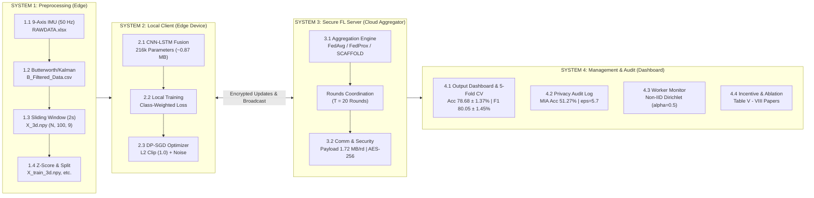

# Dokumentasi Lengkap Sistem FL-WeAR: Federated Learning for Privacy-Preserving Welder Activity Recognition

Selamat datang di repositori dokumentasi teknis menyeluruh untuk proyek **FL-WeAR (Federated Learning for Welder Activity Recognition in Manufacturing Industry)**. Dokumentasi ini disusun secara modular dan terstruktur ke dalam 4 sistem utama sesuai dengan **Fig. 1 (Overall System Architecture Pipeline)** pada naskah publikasi ilmiah.

---

## 📄 Berkas Dokumentasi Microsoft Word (.docx) Lengkap & Typografi Rumus Profesional

Setiap bagian sistem kini telah dilengkapi dengan dokumen Microsoft Word (`.docx`) mendalam yang mencakup **latar belakang teknis**, **spesifikasi data input/output**, **typografi rumus matematika profesional (*LaTeX-rendered math equation blocks*)**, **implementasi kode program Python di setiap pembahasan**, **pembahasan logika kode baris-per-baris**, **tabel metrik terformat**, serta **gambar arsitektur dan grafik ilmiah**:

1. 📘 **[Dokumentasi System 1: Preprocessing (.docx)](file:///c:/WAR-FL/Documentation/System_1_Preprocessing/Dokumentasi_System_1_Preprocessing_New.docx)** *(IMU 9-Axis, Filtering Butterworth/Kalman, Sliding Window & Normalisasi Z-Score + Typografi Rumus Lengkap + Kode & Pembahasan)*
2. 📘 **[Dokumentasi System 2: Local Client (.docx)](file:///c:/WAR-FL/Documentation/System_2_Local_Client/Dokumentasi_System_2_Local_Client.docx)** *(Model Hibrida CNN-LSTM, Class-Weighted Loss & DP-SGD + Rumus Terformat + Kode & Pembahasan + Fig. 3)*
3. 📘 **[Dokumentasi System 3: Secure FL Server (.docx)](file:///c:/WAR-FL/Documentation/System_3_Secure_FL_Server/Dokumentasi_System_3_Secure_FL_Server.docx)** *(Mesin Agregasi FedAvg/FedProx/SCAFFOLD, Komunikasi & Enkripsi AES-256 + Rumus Terformat + Kode & Pembahasan + Fig. 2, 4, 8)*
4. 📘 **[Dokumentasi System 4: Management & Audit (.docx)](file:///c:/WAR-FL/Documentation/System_4_Management_and_Audit/Dokumentasi_System_4_Management_and_Audit.docx)** *(Dashboard, Validasi Silang 5-Fold CV, Audit Privasi MIA, Ketahanan Non-IID, Skema Reward Section III-G & Studi Ablasi + Rumus Terformat + Kode & Pembahasan + Fig. 5, 6, 7)*

---

## 🗺️ Diagram Alur Arsitektur Sistem End-to-End (Systems 1–4)



---

## 📂 Struktur Folder Dokumentasi & Galeri Rumus Matematika

```text
Documentation/
│
├── README.md                                                  <-- Master Index & Architecture (Dokumen Ini)
├── fig_1_system_architecture.png                              <-- Diagram Arsitektur Utama
├── build_system_docx.py                                       <-- Generator Berkas Word (.docx) Systems 1-4
├── generate_math_formulas.py                                  <-- Generator Typografi Rumus Matematika (LaTeX Render)
│
├── formulas/                                                  <-- Folder Gambar Rumus Matematika Resolusi Tinggi
│   ├── eq_butterworth.png                                     <-- Filter Butterworth |H(f)|^2 = 1 / (1 + (f/fc)^(2n))
│   ├── eq_kalman.png                                          <-- Persamaan Status & Kovarian Rekursif Kalman Filter
│   ├── eq_zscore.png                                          <-- Standardisasi Z-Score μ_j & σ_j per Kanal
│   ├── eq_class_weighted_loss.png                             <-- Class-Weighted Cross-Entropy Loss w_c & L_local
│   ├── eq_dp_sgd.png                                          <-- L2 Gradient Clipping & Noise Gaussian DP-SGD
│   ├── eq_fedavg.png                                          <-- Agregasi Terbobot Federated Averaging (FedAvg)
│   ├── eq_fedprox.png                                         <-- Penalti Proksimal FedProx (μ/2)||w - w^t||^2
│   ├── eq_scaffold.png                                        <-- Variabel Kontrol Koreksi Gradien SCAFFOLD
│   ├── eq_reward_mechanism.png                                <-- Reward Section III-G S_k = α q_k + β ΔA_k + γ r_k
│   └── eq_latency.png                                         <-- Dekomposisi Latensi Real-Time End-to-End
│
├── System_1_Preprocessing/                                    <-- MODUL 1: Pengolahan Sinyal Mentah & Fitur
├── System_2_Local_Client/                                     <-- MODUL 2: Pelatihan Lokal & DP-SGD Klien Edge
├── System_3_Secure_FL_Server/                                 <-- MODUL 3: Server Agregasi & Protokol Keamanan
└── System_4_Management_and_Audit/                             <-- MODUL 4: Evaluasi, Audit Privasi & Monitoring
```
