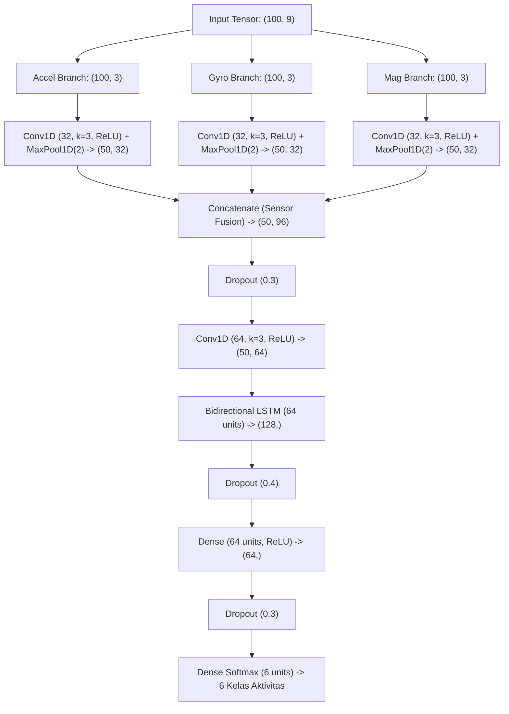

# System 2.1: CNN-LSTM Hybrid Architecture (Sensor Fusion & Sequence Modeling)

## 1. Deskripsi Komponen & Tujuan
Pada arsitektur sistem FL-WeAR, setiap perangkat pekerja las (*edge/client*) menjalankan model hibrida *Convolutional Neural Network - Long Short-Term Memory* (CNN-LSTM). Arsitektur ini dirancang untuk:
1. **Ekstraksi Fitur Spasial-Lokal (Conv1D)**: Menangkap pola osilasi frekuensi tinggi manipulasi elektroda las pada masing-masing modalitas sensor (akselerometer, giroskop, magnetometer) secara terpisah sebelum digabungkan (*sensor fusion*).
2. **Pemodelan Ketergantungan Temporal (BiLSTM/LSTM)**: Menangkap transisi sekuensial fase kerja (misal: siklus mendekati benda kerja $\rightarrow$ penyalaan busur $\rightarrow$ penarikan elektroda) yang membedakan aktivitas aktif vs istirahat.

---

## 2. File Input & Spesifikasi Data
* **Bentuk Tensor Input**: $(B, 100, 9)$
  * $B$: Batch size ($B = 32$).
  * $W = 100$: Panjang jendela observasi (2 detik @ 50 Hz).
  * $F = 9$: Sumbu sensor ($a_x, a_y, a_z, g_x, g_y, g_z, m_x, m_y, m_z$).

---

## 3. Konfigurasi Lapisan Model (Model Graph)



---

## 4. Implementasi Kode Program
* **Skrip Mandiri**: [`model_architecture.py`](file:///c:/WAR-FL/Documentation/System_2_Local_Client/2_1_CNN_LSTM_Architecture/model_architecture.py)
* **Rujukan Notebook Utama**: [`main.ipynb`](file:///c:/WAR-FL/main.ipynb) pada **Cell 0, 51–55, 63–65**.

```python
# Definisi arsitektur model
inputs = Input(shape=(100, 9))
accel_input, gyro_input, mag_input = inputs[:, :, 0:3], inputs[:, :, 3:6], inputs[:, :, 6:9]

# Multibranch Feature Extractors
x_a = MaxPooling1D(2)(Conv1D(32, 3, activation="relu", padding="same")(accel_input))
x_g = MaxPooling1D(2)(Conv1D(32, 3, activation="relu", padding="same")(gyro_input))
x_m = MaxPooling1D(2)(Conv1D(32, 3, activation="relu", padding="same")(mag_input))

# Fusion + BiLSTM
fused = Dropout(0.3)(Concatenate(axis=-1)([x_a, x_g, x_m]))
x = Conv1D(64, 3, activation="relu", padding="same")(fused)
x = Dropout(0.4)(Bidirectional(LSTM(64))(x))

# Classifier
x = Dropout(0.3)(Dense(64, activation="relu")(x))
outputs = Dense(6, activation="softmax")(x)
```

---

## 5. File Output yang Dihasilkan
1. [`model_architecture_summary.txt`](file:///c:/WAR-FL/Documentation/System_2_Local_Client/2_1_CNN_LSTM_Architecture/model_architecture_summary.txt): Ringkasan tekstual parameter per layer.
2. [`fig_3_cnn_lstm_architecture.png`](file:///c:/WAR-FL/Documentation/System_2_Local_Client/2_1_CNN_LSTM_Architecture/fig_3_cnn_lstm_architecture.png): Visualisasi diagram blok arsitektur standar IEEE.
3. [`trainable_har_model3.tflite`](file:///c:/WAR-FL/Documentation/System_2_Local_Client/2_1_CNN_LSTM_Architecture/trainable_har_model3.tflite): Model TFLite on-device training yang diekspor untuk deployment edge mobile.
4. [`trainable_export_manifest.json`](file:///c:/WAR-FL/Documentation/System_2_Local_Client/2_1_CNN_LSTM_Architecture/trainable_export_manifest.json): Metadata signature model (fungsi `infer`, `train`, dan `export_weights`).

---

## 6. Korelasi dengan Naskah Paper (`paper_draft_filled.md`)
* **Section III-C (Local Model: CNN-LSTM Architecture)**: Menjelaskan peranan layer Conv1D dan LSTM dalam pengenalan sinyal las.
* **TABLE I (CNN-LSTM Model Architecture)**: Menyajikan perincian ukuran output shape dan jumlah parameter model (~0.87 MB float32).
* **Fig. 3 (CNN-LSTM Architecture Block Diagram)**: Visualisasi diagram arsitektur model.
