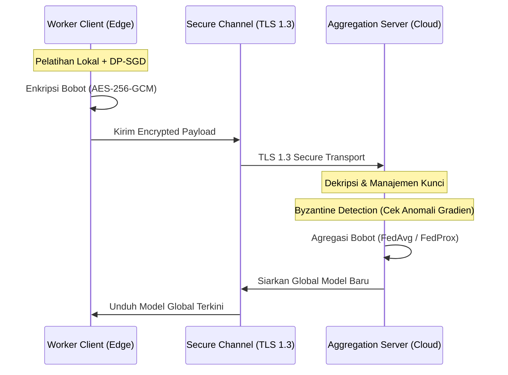

# System 3.2: Communication Efficiency & Security Architecture

## 1. Deskripsi Komponen & Tujuan
Dalam penerapan industri nyata pada lantai pabrik (*manufacturing floor*), perangkat edge pekerja las terhubung ke server melalui jaringan nirkabel pabrik (*factory Wi-Fi / Industrial IoT*). Modul ini menganalisis:
1. **Beban Volume Komunikasi**: Perhitungan ukuran payload model per ronde vs transmisi data mentah terpusat.
2. **Protokol Keamanan & Kerahasiaan Data**: Penerapan enkripsi **AES-256-GCM**, transport **TLS 1.3**, dan mekanisme pertahanan terhadap anomali gradien (*Byzantine detection*).

---

## 2. Analisis Beban & Volume Komunikasi

### A. Parameter Komunikasi Model
* **Jumlah Parameter Model**: $216,582$ parameter float32 (4 bytes per parameter).
* **Ukuran Bobot Model**:
  $$\text{Ukuran Payload} = 216,582 \times 4 \text{ bytes} \approx 866.3 \text{ KB} \approx 0.866 \text{ MB}$$
* **Trafik Komunikasi Dua Arah per Klien**:
  $$\text{Data per Ronde} = 0.866 \text{ MB (Upload)} + 0.866 \text{ MB (Download)} \approx 1.72 \text{ MB}$$
* **Total Volume Komunikasi ($T=20$ Ronde, $K=5$ Klien)**:
  $$\text{Total Transmisi} = 20 \times 5 \times 1.72 \text{ MB} = 172.00 \text{ MB}$$

### B. Evaluasi vs Centralized Baseline
Dibandingkan pengiriman data mentah satu kali (*one-shot transmission* $\sim 122.9 \text{ MB}$), FL-WeAR memiliki overhead komunikasi sebesar **+40.0%**. Namun, FL-WeAR mendistribusikan beban transmisi ini secara bertahap selama 20 ronde dan **menjamin 100% data mentah tidak pernah keluar dari perangkat lokal pekerja**.

---

## 3. Spesifikasi Protokol Keamanan (Security Layer)

1. **AES-256 Key Management**: Enkripsi payload parameter gradien menggunakan kunci simetris terotentikasi.
2. **TLS 1.3 Transport**: Mengamankan saluran komunikasi antar-node dari serangan *Man-in-the-Middle* (MitM).
3. **Byzantine Detection**: Server memeriksa norma gradien $(\|g\|_2)$ dan *cosine similarity* untuk mendeteksi serta membuang pembaruan klien yang rusak atau mengalami serangan sabotase (*poisoning attack*).

---

## 4. Implementasi Kode Program
* **Skrip Mandiri**: [`communication_protocol.py`](file:///c:/WAR-FL/Documentation/System_3_Secure_FL_Server/3_2_Communication_Protocol_and_Security/communication_protocol.py)
* **Rujukan Notebook Utama**: [`main.ipynb`](file:///c:/WAR-FL/main.ipynb) pada **Cell 41 & Cell 78**.

---

## 5. File Output yang Dihasilkan
1. [`communication_cost_summary.csv`](file:///c:/WAR-FL/Documentation/System_3_Secure_FL_Server/3_2_Communication_Protocol_and_Security/communication_cost_summary.csv): Tabel perbandingan volume transmisi vs baseline.
2. [`fig_8_communication_cost.png`](file:///c:/WAR-FL/Documentation/System_3_Secure_FL_Server/3_2_Communication_Protocol_and_Security/fig_8_communication_cost.png): Grafik batang biaya komunikasi per metode.
3. [`fig_2_fl_architecture.png`](file:///c:/WAR-FL/Documentation/System_3_Secure_FL_Server/3_2_Communication_Protocol_and_Security/fig_2_fl_architecture.png): Diagram lengkap arsitektur komunikasi klien-server-manajemen.

---

## 6. Korelasi dengan Naskah Paper (`paper_draft_filled.md`)
* **Section V-E (Communication Efficiency)**: Menguraikan volume total 172.00 MB dan pertimbangan overhead versus keuntungan tata kelola privasi berkelanjutan.
* **TABLE VII (Communication Evaluation Results)**: Rekapitulasi volume transmisi per round dan total sent.
* **Fig. 8 (Communication Cost Bar Chart)**: Visualisasi perbandingan biaya komunikasi.
