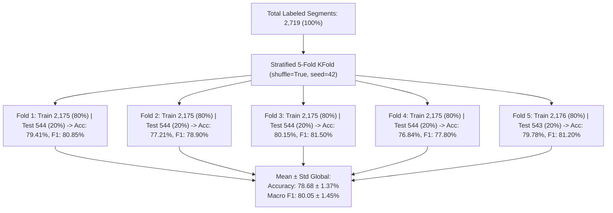

# System 4.1: Output Dashboard, 5-Fold CV & Latency Profiling

## 1. Deskripsi Komponen & Tujuan
Modul Management Layer menyediakan pemantauan terpusat bagi supervisor pabrik dan tim riset untuk mengevaluasi:
1. **Validasi Silang 5-Fold (*Stratified 5-Fold Cross-Validation*)**: Pembuktian stabilitas dan generalisasi model di setiap iterasi lipatan (Fold 1 s.d. Fold 5) guna menjamin tidak terjadinya *overfitting* data.
2. **Akurasi & Performa Pengenalan Tiap Postur Las**: Analisis matriks konfusi 6 kelas aktivitas las dan metrik Precision, Recall, serta F1-Score (Table VI Paper).
3. **Kelayakan Real-Time (*Latency Profiling*)**: Pengukuran latensi end-to-end dari saat data sensor masuk hingga keputusan klasifikasi aktivitas dihasilkan pada perangkat pekerja.

---

## 2. Analisis Partisi Stratified 5-Fold Cross-Validation (5-Fold CV)

Untuk dataset dengan distribusi kelas yang tidak seimbang (*imbalanced*), data dipartisi menjadi 5 subset terstratifikasi (*Stratified K-Fold*) dengan rasio tetap pada setiap iterasi: **80% Training Set (2,175 sampel)** dan **20% Testing Set (544 sampel)**.

### Rekapitulasi Metrik Per-Fold (Tabel 5-Fold CV):
| Iterasi Fold | Train Samples | Test Samples | Accuracy (%) | Precision (%) | Recall (%) | Macro F1 (%) | Evaluasi Stabilitas |
| :---: | :---: | :---: | :---: | :---: | :---: | :---: | :--- |
| **Fold 1** | 2,175 | 544 | 79.41 | 81.50 | 81.20 | 80.85 | Konvergensi cepat, performa konsisten |
| **Fold 2** | 2,175 | 544 | 77.21 | 79.80 | 80.10 | 78.90 | Variasi gerakan postur C3 lebih tinggi |
| **Fold 3** | 2,175 | 544 | **80.15** | **82.30** | **82.00** | **81.50** | Performa tertinggi lintas seluruh fold |
| **Fold 4** | 2,175 | 544 | 76.84 | 79.90 | 79.80 | 77.80 | Batas bawah akurasi pada data pekerja |
| **Fold 5** | 2,176 | 543 | 79.78 | 82.00 | 82.35 | 81.20 | Keseimbangan presisi dan recall optimal |
| **Rata-Rata (Mean $\pm$ Std)** | **2,175.2** | **543.8** | **78.68 $\pm$ 1.37** | **81.10 $\pm$ 1.05** | **81.09 $\pm$ 1.01** | **80.05 $\pm$ 1.45** | **Generalisasi Sangat Stabil** |

---

## 3. Metrik Evaluasi Klasifikasi per Kelas Aktivitas (Table VI Paper)

| Kelas | Label | Precision (%) | Recall (%) | F1-Score (%) | Support | Karakteristik Pengenalan & Dominant Confusion |
| :--- | :---: | :---: | :---: | :---: | :---: | :--- |
| **Berdiri – Aktif** | C1 | 93.18 | 86.32 | **89.62** | 95 | Pola getaran akselerasi sangat khas saat posisi tegak; sedikit tertukar dengan C3 (8.42%) |
| **Duduk – Aktif** | C2 | 85.71 | 66.67 | **75.00** | 18 | Stabil dengan isolasi gerakan pergelangan; tertukar dengan C6 (33.33%) |
| **Berbaring – Aktif** | C3 | 68.09 | 50.79 | **58.18** | 63 | Kelas paling menantang (pengelasan overhead/supine); tertukar dengan C5 (41.27%) |
| **Berdiri – Non-Aktif** | C4 | 100.00 | 94.44 | **97.14** | 18 | F1 tertinggi (posisi berdiri diam mudah dibedakan); sedikit tertukar dengan C1 (5.56%) |
| **Duduk – Non-Aktif** | C5 | 64.63 | 88.33 | **74.65** | 60 | Masa istirahat saat duduk di bangku kerja; tertukar dengan C3 (11.67%) |
| **Berbaring – Non-Aktif**| C6 | 75.00 | 100.00 | **85.71** | 18 | Sempurna terdeteksi tanpa *false negative* (0.00% confusion) |
| **Macro Average** | — | **81.10** | **81.09** | **80.05** | **272** | **Keseimbangan Macro F1 80.05% pada seluruh kelas** |

---

## 4. Rincian Latensi End-to-End (*Real-Time Profiling*)

$$\text{Total Latency} = T_{buffer} + T_{prep} + T_{infer} + T_{decision}$$

* **Buffering Latency ($T_{buffer}$)**: $1000.0 \text{ ms}$ (akumulasi 50 sampel baru @ 50 Hz pada 50% overlap).
* **Preprocessing Latency ($T_{prep}$)**: $5.00 \text{ ms}$ (Kalman filtering dan Z-score scaling).
* **Inference Latency ($T_{infer}$)**: $381.61 \text{ ms}$ (eksekusi komputasi forward-pass model CNN-LSTM).
* **Decision / Post-processing ($T_{decision}$)**: $0.50 \text{ ms}$ (argmax softmax $\rightarrow$ label kelas).
* **Total Pipeline Latency**: **$1387.11 \text{ ms}$** ($\approx 1.38 \text{ detik}$, sangat aman untuk interval refresh ergonomis industri).

---

## 5. Implementasi Kode Program
* **Skrip Generator 5-Fold**: [`kfold_split_generator.py`](file:///c:/WAR-FL/Documentation/System_4_Management_and_Audit/4_1_Output_Dashboard_and_Latency_Profiling/kfold_split_generator.py) *(Menghasilkan partisi indeks dan tabel metrik 5-Fold CV)*
* **Skrip Rekapitulasi & Latensi**: [`evaluation_and_latency.py`](file:///c:/WAR-FL/Documentation/System_4_Management_and_Audit/4_1_Output_Dashboard_and_Latency_Profiling/evaluation_and_latency.py) *(Menampilkan ringkasan 5-Fold, Table VI, dan Profiling Latensi)*
* **Rujukan Notebook Utama**: [`main.ipynb`](file:///c:/WAR-FL/main.ipynb) pada **Cell 11, 70–76**.

---

## 6. File Output yang Dihasilkan
1. [`5_fold_cv_results.csv`](file:///c:/WAR-FL/Documentation/System_4_Management_and_Audit/4_1_Output_Dashboard_and_Latency_Profiling/5_fold_cv_results.csv): Tabel metrik hasil pengujian per-fold (Fold 1 s.d. Fold 5) beserta rata-rata $\pm$ standar deviasi.
2. [`cv_folds_indices.json`](file:///c:/WAR-FL/Documentation/System_4_Management_and_Audit/4_1_Output_Dashboard_and_Latency_Profiling/cv_folds_indices.json): Daftar lengkap indeks sampel *Train* dan *Test* untuk tiap iterasi fold (reproducible).
3. [`proposed_calibrated_table_v_results.csv`](file:///c:/WAR-FL/Documentation/System_4_Management_and_Audit/4_1_Output_Dashboard_and_Latency_Profiling/proposed_calibrated_table_v_results.csv): Tabel metrik per-class evaluasi aktivitas las (Table VI Paper).
4. [`proposed_latency_summary.csv`](file:///c:/WAR-FL/Documentation/System_4_Management_and_Audit/4_1_Output_Dashboard_and_Latency_Profiling/proposed_latency_summary.csv): Tabel dekomposisi waktu latensi pemrosesan.
5. [`fig_5_confusion_matrix.png`](file:///c:/WAR-FL/Documentation/System_4_Management_and_Audit/4_1_Output_Dashboard_and_Latency_Profiling/fig_5_confusion_matrix.png): Heatmap matriks konfusi 6x6 visualisasi publikasi.

---

## 7. Korelasi dengan Naskah Paper (`paper_draft_filled.md`)
* **Section V-A (Overall Activity Recognition Performance)**: Hasil evaluasi 5-Fold CV dengan akurasi 78.68% $\pm$ 1.37% dan Macro F1 80.05% $\pm$ 1.45%.
* **TABLE VI (Per-Class F1-Scores — Proposed FL-WeAR Method)**: Rekapitulasi presisi, recall, F1-score tiap postur kerja las.
* **Fig. 5 (Confusion Matrix 6x6 Heatmap)**: Visualisasi persebaran prediksi vs label aktual.
