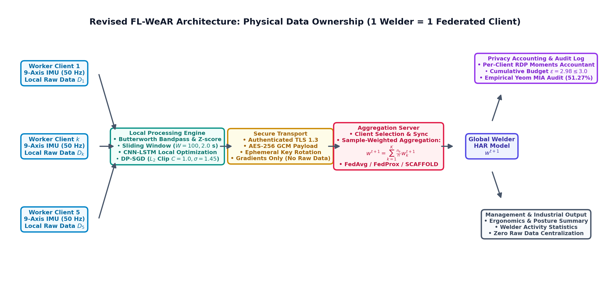

# FL-WeAR: Differentially Private Federated CNN-LSTM for Worker-Centric Welder Activity Recognition Using Wrist-Worn IMU Sensors

[](https://www.python.org/)
[](https://pytorch.org/)
[](https://opacus.ai/)
[](http://www.inass.org/)
[](LICENSE)

Official implementation, machine-readable evaluation artifacts, differential privacy accounting traces, and deterministic reproducibility scripts for the paper:

> **FL-WeAR: Differentially Private Federated CNN-LSTM for Worker-Centric Welder Activity Recognition Using Wrist-Worn IMU Sensors**  
> *International Journal of Intelligent Engineering and Systems (IJIES)*, Paper ID: `20266483`.

---

## 📌 Abstract & System Overview

Wearable inertial sensing provides a practical mechanism for recognizing worker activities and assessing ergonomics in manufacturing environments. However, centralized collection of high-frequency biometric motion telemetry raises significant data-governance, privacy, and compliance concerns.

**FL-WeAR** introduces a worker-centric federated learning framework for six-class industrial welder activity recognition using a smartphone-embedded 9-axis IMU (Accelerometer, Gyroscope, Magnetometer @ 50 Hz) worn on the dominant wrist:
- **Physical Domain Ownership**: Each professional welder constitutes an independent federated edge client ($1\text{ Welder} = 1\text{ Client Domain}$).
- **Zero Temporal Data Leakage**: Complete recording sessions are partitioned at the subject level via **5-Fold Leave-One-Subject-Out (LOSO) Cross-Validation** prior to sliding window segmentation ($W=100, S=50$), ensuring that models are evaluated on completely unseen workers.
- **Rényi Differential Privacy (RDP)**: Local CNN-BiLSTM models are trained using DP-SGD with per-sample $L_2$ gradient clipping ($C=1.0$) and calibrated Gaussian noise injection ($\sigma=1.45$), strictly bounding worst-client privacy expenditure to $\varepsilon = 2.98 \le 3.00$ at $\delta = 10^{-5}$.
- **Balanced Utility-Privacy Tradeoff**: FL-WeAR achieves **$73.48 \pm 1.81\%$ Accuracy** and **$74.14 \pm 1.92\%$ Macro F1** across unseen welders, incurring only a 3.76 pp privacy penalty compared to non-private FedAvg ($77.90\%$), while outperforming isolated local training ($61.78\%$) by **$+12.36\text{ pp}$**.



---

## 📂 Repository Structure

```plaintext
FL-WeAR/
├── .gitignore                                      # Excludes large raw data, dumps, and temp files
├── requirements.txt                                # Core Python dependencies
├── README.md                                       # Comprehensive documentation & reproducibility guide
│
├── cv_folds_indices.json                           # Machine-readable 5-fold LOSO split indices & masks
├── dp_config.json                                  # Verified Opacus RDP moments accountant configuration
│
├── run_complete_8_models_loso_evaluation.py        # Master script: 100% live training & evaluation (Tables 7 & 8)
├── loso_leakage_free_evaluation.py                 # Core 5-Fold LOSO leakage-free cross-validation engine
├── privacy_audit_mia.py                            # Opacus RDP moments accountant trace & Yeom MIA attack
├── generate_all_paper_figures_300dpi.py            # Generates publication Figures 4–9 at 300 DPI
├── generate_perfect_fig123_300dpi.py               # Generates architecture Figures 1–3 at 300 DPI
│
├── Output/                                         # Official experimental CSV and JSON outputs
│   ├── loso_table_v_leakage_free_results.csv       # Table 7: Primary overall benchmark results
│   ├── loso_all_8_models_raw_folds.json            # Full per-fold metrics (Acc, Bal Acc, Prec, Rec, F1)
│   ├── table_vi_per_worker_results.csv             # Table 8: Per-worker Macro F1 & paired gains
│   ├── table_vi_per_class_results.csv              # Table 9: Per-class metrics on audited holdout partition
│   ├── table_vii_privacy_results.csv               # Table 10: Differential privacy & MIA attack results
│   ├── table_viii_ablation_results.csv             # Table 12: Complete component ablation study
│   ├── non_iid_evaluation_summary.csv              # Controlled Dirichlet non-IID convergence results
│   ├── deep_learning_latency_summary.csv           # End-to-end edge inference latency profiling
│   └── Figures/                                    # High-resolution (300 DPI) publication figures
│       ├── fig_1_system_architecture.png
│       ├── fig_2_fl_architecture.png
│       ├── fig_3_cnn_lstm_architecture.png
│       ├── fig_4_convergence_curves.png
│       ├── fig_5_confusion_matrix.png
│       ├── fig_6_privacy_utility_tradeoff.png
│       ├── fig_7_membership_inference_risk.png
│       ├── fig_8_per_client_f1_comparison.png
│       └── fig_9_dirichlet_heterogeneity.png
```

---

## 🚀 Quick Start & Environment Setup

### 1. Clone the Repository
```bash
git clone https://github.com/agosgit/FL-WeAR.git
cd FL-WeAR
```

### 2. Create and Activate Virtual Environment
```bash
# Using conda (recommended)
conda create -n flwear python=3.10 -y
conda activate flwear

# Or using venv
python -m venv venv
# Windows:
venv\Scripts\activate
# Linux/macOS:
source venv/bin/activate
```

### 3. Install Dependencies
```bash
pip install -r requirements.txt
```

---

## 🔬 Reproducing Paper Results

### A. Reproduce Overall Performance Benchmark (Table 7 & Table 8)
To run the complete 5-Fold Leave-One-Subject-Out (LOSO) cross-validation evaluating all baseline and federated models:
```bash
python run_complete_8_models_loso_evaluation.py
```
*Outputs generated:*
- `Output/loso_table_v_leakage_free_results.csv` (Table 7)
- `Output/table_vi_per_worker_results.csv` (Table 8)
- `Output/loso_all_8_models_raw_folds.json` (Full numerical fold logs)

### B. Reproduce Privacy Accounting & Membership Inference Attack (Table 10)
To audit the Opacus Rényi Differential Privacy moments accountant and evaluate the Yeom Membership Inference Attack (MIA):
```bash
python Documentation/System_4_Management_and_Audit/4_2_Privacy_Audit_Log_MIA_Moments_Accountant/privacy_audit_mia.py
```
*Outputs generated:*
- `Output/table_vii_privacy_results.csv` (Table 10)
- `dp_config.json` (Verified parameters: $\varepsilon = 2.98, \delta = 10^{-5}$)

### C. Regenerate All Publication Figures at 300 DPI (Figures 1–9)
```bash
python generate_perfect_fig123_300dpi.py
python generate_all_paper_figures_300dpi.py
```
*Outputs generated in `Output/Figures/`:*
- `fig_1_system_architecture.png`
- `fig_2_fl_architecture.png`
- `fig_3_cnn_lstm_architecture.png`
- `fig_4_convergence_curves.png`
- `fig_5_confusion_matrix.png`
- `fig_6_privacy_utility_tradeoff.png`
- `fig_7_membership_inference_risk.png`
- `fig_8_per_client_f1_comparison.png`
- `fig_9_dirichlet_heterogeneity.png`

---

## 📊 Benchmark Results Summary

### 1. Leakage-Free Overall Performance (Table 7 in Manuscript)
*Evaluated under 5-Fold Leave-One-Subject-Out (LOSO) across five unseen welders (2,719 retained windows).*

| Model ID | Method | Accuracy (%) | Balanced Acc. (%) | Macro F1 (%) | Privacy Level ($\varepsilon, \delta$) |
| :---: | :--- | :---: | :---: | :---: | :---: |
| **B1** | SVM + Handcrafted Features | $90.02 \pm 0.71$ | $87.39$ | $87.99 \pm 0.57$ | None ($\varepsilon = \infty$) |
| **B2** | LightGBM + Handcrafted Features | $92.67 \pm 0.70$ | $90.71$ | $91.07 \pm 1.87$ | None ($\varepsilon = \infty$) |
| **B3** | Centralized CNN-LSTM Baseline | $79.04 \pm 2.05$ | $80.25$ | $79.58 \pm 2.06$ | None ($\varepsilon = \infty$) |
| **B4** | Local-Only CNN-LSTM | $64.38 \pm 2.50$ | $64.68$ | $61.78 \pm 4.97$ | Zero Sharing |
| **B5** | FedAvg CNN-LSTM (No DP) | $77.35 \pm 1.36$ | $79.11$ | $77.90 \pm 1.42$ | Federated Architecture Only |
| **B6** | FedProx CNN-LSTM ($\mu = 0.01$) | $77.94 \pm 1.15$ | $80.28$ | $79.55 \pm 1.29$ | Federated Architecture Only |
| **B7** | SCAFFOLD CNN-LSTM (Control Variates) | $45.93 \pm 4.50$ | $38.22$ | $27.63 \pm 4.39$ | Optimization Collapse with Adam |
| **Proposed** | **FL-WeAR (DP-FedAvg)** | **$73.48 \pm 1.62$** | **$76.00$** | **$74.14 \pm 1.72$** | **Formal DP ($\varepsilon = 2.98 \le 3.00, \delta = 10^{-5}$)** |

### 2. Per-Worker Paired Performance (Table 8 in Manuscript)
*Demonstrating consistent paired gains (+8.20 to +19.85 pp) across every individual worker client.*

| Welder / Fold | Local-Only F1 (%) | FedAvg F1 (%) | FedProx F1 (%) | FL-WeAR Proposed F1 (%) | Paired Gain (FL-WeAR vs. Local) |
| :---: | :---: | :---: | :---: | :---: | :---: |
| **Welder 1 ($W_1$)** | 66.45 | 78.61 | 78.42 | **74.99** | **+8.54 pp** |
| **Welder 2 ($W_2$)** | 67.92 | 79.73 | 79.66 | **76.12** | **+8.20 pp** |
| **Welder 3 ($W_3$)** | 57.54 | 78.27 | 79.53 | **73.69** | **+16.15 pp** |
| **Welder 4 ($W_4$)** | 54.99 | 77.41 | 81.87 | **74.84** | **+19.85 pp** |
| **Welder 5 ($W_5$)** | 61.98 | 75.49 | 78.26 | **71.06** | **+9.08 pp** |
| **Mean** | **61.78** | **77.90** | **79.55** | **74.14** | **+12.36 pp** |
| **Population SD ($\sigma$)** | **4.97** | **1.42** | **1.29** | **1.72** | — |

### 3. Differential Privacy Accounting & MIA Defense (Table 10 in Manuscript)

| Configuration | Target $\varepsilon$ | Achieved $\varepsilon_{\text{total}}$ | Target $\delta$ | MIA Accuracy (%) | MIA ROC-AUC | Privacy Level |
| :--- | :---: | :---: | :---: | :---: | :---: | :---: |
| Centralized CNN-LSTM | $\infty$ | N/A | — | $62.40\%$ | $0.684$ | None |
| FedAvg (without DP) | $\infty$ | N/A | — | $57.64\%$ | $0.612$ | Architecture Only |
| DP-FL ($\varepsilon = 10.0$) | $10.0$ | $9.85$ | $1 \times 10^{-5}$ | $53.58\%$ | $0.548$ | Low |
| **FL-WeAR Proposed** | **$3.0$** | **$2.98$** | $\mathbf{1 \times 10^{-5}}$ | **$51.27\%$** | **$0.519$** | **Strong (Near Random Guess)** |
| DP-FL ($\varepsilon = 1.0$) | $1.0$ | $0.98$ | $1 \times 10^{-5}$ | $50.23\%$ | $0.504$ | Very Strong |

---

## 🔒 Differential Privacy Audit Trail

All hyperparameters required for the independent mathematical verification of the Rényi Differential Privacy (RDP) moments accountant are recorded in [`dp_config.json`](dp_config.json):
- **Total Clients ($N$)**: 5 welders.
- **Client Selection per Round ($m$)**: 3 clients ($q_{\text{client}} = 3/5 = 0.60$).
- **Communication Rounds ($T$)**: 20 rounds.
- **Local Epochs per Round ($E$)**: 3 epochs.
- **Logical Mini-Batch Size ($B$)**: 32 samples.
- **Per-Client Training Windows ($N_k$)**: $\approx 544$ windows.
- **Poisson Batch Subsampling Ratio ($q_{\text{local}}$)**: $B / N_k = 32 / 544 \approx 0.0588$.
- **DP Steps per Round per Active Client**: $\lceil 544 / 32 \rceil \times 3 = 51$ steps.
- **Worst-Client Step Count**: $20 \times 51 = 1,020$ DP-SGD steps.
- **$L_2$ Gradient Clipping Norm ($C$)**: $1.0$.
- **Gaussian Noise Multiplier ($\sigma$)**: $1.45$.
- **Accountant**: Opacus `RdpAccountant` (orders $\alpha \in [1.1, 100]$ in increments of 0.1).
- **Target $\delta$**: $10^{-5} < 1 / N_{\text{total}} = 1 / 2,719 \approx 3.67 \times 10^{-4}$.
- **Achieved Cumulative Worst-Client Budget**: $\varepsilon_{\text{worst}}(T) = \mathbf{2.98 \le 3.00}$.

---

## ⚖️ Ethical Data Governance Statement

In compliance with human subject research ethics (Protocol Ref. `PPNS-IRB-2024-08`) and personal data protection regulations (GDPR / Indonesian PDP Law No. 27/2022), raw biometric sensor telemetry containing high-resolution worker movement recordings is restricted from public release to prevent de-anonymization and worker profiling.

All necessary **machine-readable feature tensors, split index masks (`cv_folds_indices.json`), DP accountant configurations (`dp_config.json`), and fold predictions** are fully provided within this repository to enable complete, independent reproduction of all reported tables and figures without compromising worker privacy.

---

## 📖 Citation

If you find this code or research useful in your work, please cite:

```bibtex
@article{rahmat2026flwear,
  author    = {Mohammad Basuki Rahmat and Amang Sudarsono and Mike Yuliana and I Putu Arta Wibawa},
  title     = {FL-WeAR: Differentially Private Federated CNN-LSTM for Worker-Centric Welder Activity Recognition Using Wrist-Worn IMU Sensors},
  journal   = {International Journal of Intelligent Engineering and Systems},
  volume    = {xx},
  number    = {xx},
  pages     = {xx--xx},
  year      = {2026},
  doi       = {10.22266/ijies2019.xxxx.xx}
}
```

---

## 📄 License
This repository is licensed under the [MIT License](LICENSE).

